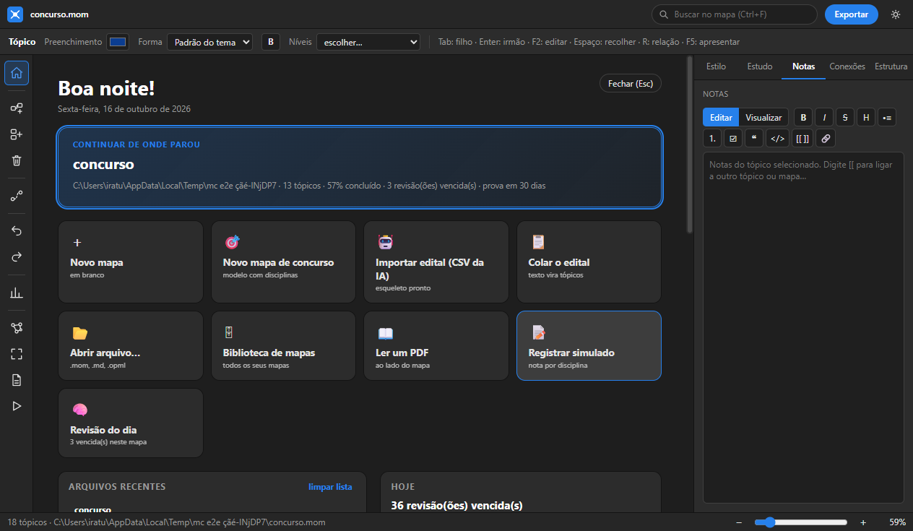
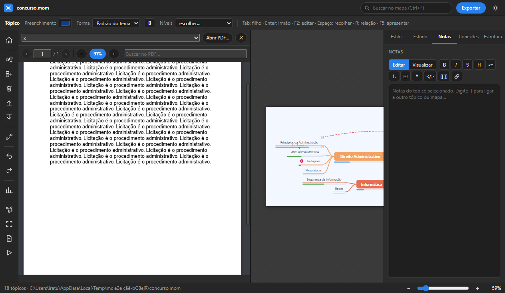
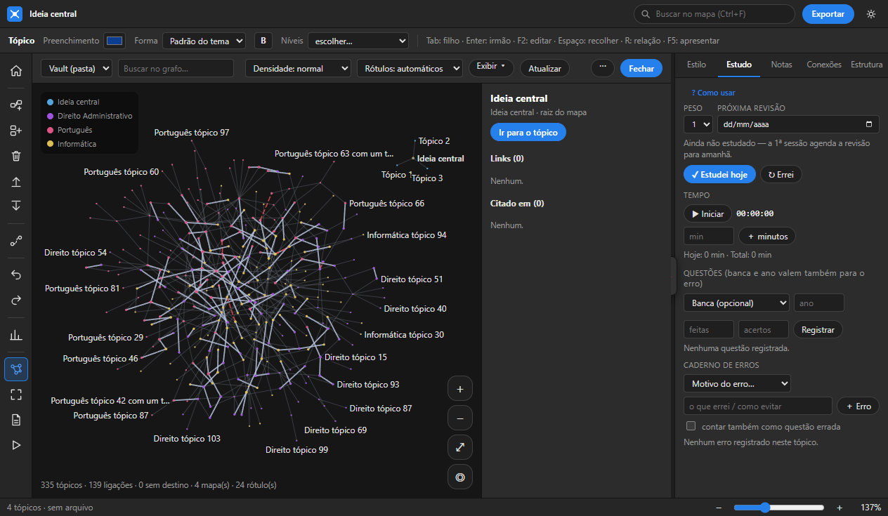
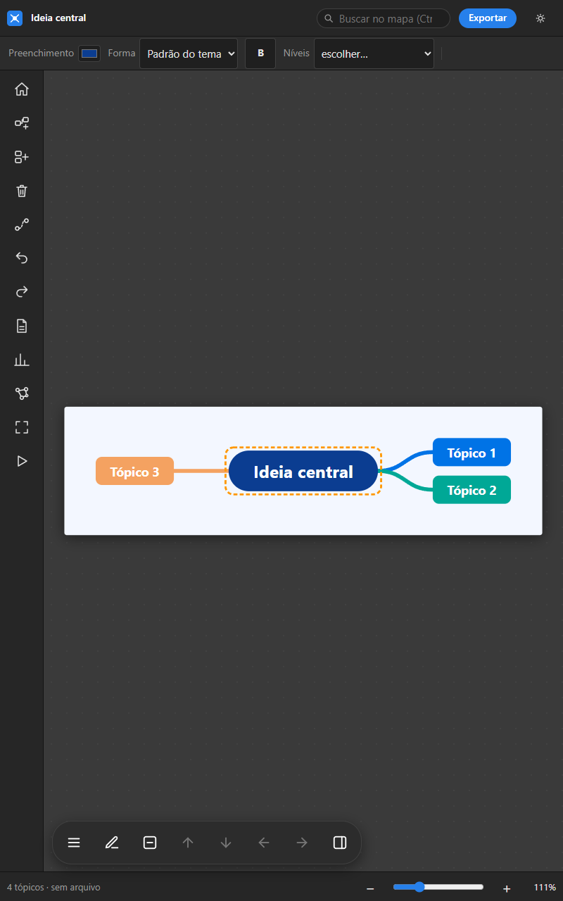

# MindCraft

**Mapas mentais e rotina de estudos para concursos e provas.** Você monta o mapa do edital, estuda cada tópico com PDF, vídeo e questões ao lado, e o app avisa quando é hora de revisar.

- Desktop: **Windows** (instalador) · **macOS** e **Linux** (gerados a partir do código)
- Tablet: **Android** (APK)
- Compatível com arquivos **Mindomo `.mom`**: abre, salva e preserva o que não entende

## Telas

| Tela inicial | Leitor de PDF ao lado do mapa |
|---|---|
|  |  |
| **Rede de conhecimento** | **Tablet** |
|  |  |

## Funcionalidades

**Mapa mental**
- Tópicos, notas em Markdown e `[[links]]` entre tópicos
- Relações com seta entre tópicos distantes
- Marcadores, progresso, cores, cinco temas visuais, recolher ramos por nível
- Reordenar com teclado, toque ou arrastar; copiar, colar e desfazer

**Edital para mapa**
- Cole o conteúdo programático e ele vira tópicos
- **Modelo de concurso** com disciplinas prontas
- **CSV gerado por IA**: a Ajuda traz um modelo para transformar o PDF do edital em planilha. A importação mostra uma prévia antes de criar o mapa
- Planilha de planejamento: exporte, edite no Excel e importe de volta

**Estudo**
- **Revisão espaçada** (1, 7, 15, 30, 60 e 120 dias): "Estudei hoje" avança, "Errei" volta ao início
- Por tópico: peso, próxima revisão, cronômetro, minutos, questões feitas e acertos
- **Painel de estudos** (Ctrl+E): contagem regressiva da prova, progresso por disciplina, sequência de dias, tempo da semana e fila de revisões
- **Caderno de erros** e metas semanais
- Simulados por disciplina e questões por banca e ano
- Relatório em `.md` ou `.docx` com os mesmos números do painel

**PDF, vídeo e navegador ao lado do mapa**
- **Leitor de PDF:** selecione um trecho e crie um tópico ou nota com a página e o destaque. Clique no destaque para ir ao tópico
- **Player de vídeo:** videoaulas locais ou do YouTube, com carimbos de tempo ligados ao mapa
- **Navegador:** para questões e leis, com favoritos de concursos
- Abas no topo, como em um navegador. Com uma mídia em foco, as ações do mapa somem e o mapa continua visível

**Rede de conhecimento**
- Visão do mapa como rede, com os links entre tópicos e entre mapas da biblioteca

**Dados**
- **Biblioteca de mapas** no próprio app (SQLite)
- **Cópia de segurança** em pacote `.mcpack`, com lembrete, e restauração que nunca sobrescreve
- **Revisão do dia** e agenda `.ics` para o calendário
- Aviso diário de revisões vencidas (opcional)

**Mindomo**
- Abre e salva `.mom`. Tópicos soltos aparecem à direita do mapa e podem ser trazidos para a árvore
- A lixeira do Mindomo, o histórico, as relações e os temas são preservados ao salvar
- Exporta Markdown, OPML, PDF, Word, PNG e SVG

**Tablet Android**
- A mesma interface do desktop, com menu e barra adaptados ao toque
- Cópia de segurança para uma pasta escolhida

## Instalar

**Windows:** baixe `MindCraft Setup x.y.z.exe` na página de [releases](https://github.com/iratuan/mindCraft/releases) e execute. O instalador não é assinado, então o Windows pode mostrar um aviso de editor desconhecido: clique em "Mais informações" e depois "Executar assim mesmo".

**Android:** baixe `MindCraft-x.y.z.apk`, abra o arquivo e permita a instalação de fontes desconhecidas quando o aparelho pedir.

**macOS e Linux:** ainda sem instalador publicado. Gere a partir do código (veja abaixo) com `npm run dist`. No macOS, a primeira abertura pede confirmação em "Ajustes → Privacidade e Segurança".

## Usar

1. Abra o app e escolha **Novo mapa de concurso** ou **Importar edital**.
2. Estude cada tópico: peso, cronômetro e questões no painel da direita. O PDF, o vídeo ou o navegador ficam à esquerda.
3. Toda manhã, abra o **Painel de estudos** (Ctrl+E) e faça a fila de revisões.
4. Faça uma **cópia de segurança** de vez em quando (Tela inicial). Guarde o arquivo fora do computador.

Atalhos completos: **F1** ou Ajuda → Atalhos. Explicações de cada função: Ajuda → Manual de uso.

## Para desenvolver

```bash
npm install
npm start          # abre o app
npm run check      # lint + testes unitários + paridade com o núcleo web
npm run e2e        # testes ponta a ponta no Electron real (34 etapas)
npm run qa         # QA por funcionalidade, com entrada real (81 casos)
npm run dist       # instalador do sistema atual, em dist/
```

Android: `cd tablet && node scripts/release.js` gera e assina o APK em `tablet/dist/`. A chave de assinatura fica em `tablet/keystore/`, fora do Git: **faça uma cópia**, sem ela não é possível atualizar o app instalado.

Estrutura: `core/` (regras de negócio puras, sem Electron nem DOM) · `electron/` (processo principal) · `renderer/` (interface) · `platform/` (versão web, para o tablet) · `tablet/` (Capacitor) · `test/`.

Documentação para quem vai evoluir o projeto:
- [`CLAUDE.md`](CLAUDE.md): regras, comandos e armadilhas. Comece por aqui.
- [`docs/ARCHITECTURE.md`](docs/ARCHITECTURE.md) e [`docs/DECISIONS.md`](docs/DECISIONS.md): arquitetura e decisões
- [`docs/TESTING.md`](docs/TESTING.md) e [`docs/CONTRIBUTING.md`](docs/CONTRIBUTING.md): testes e contribuição
- [`CHANGELOG.md`](CHANGELOG.md): histórico de versões

## Limitações conhecidas

- **Mindomo:** ícones, anexos, tarefas e Gantt não são importados. Relações do Mindomo são preservadas no arquivo, mas ainda não aparecem no mapa. Tópicos soltos são só de leitura até serem trazidos para a árvore.
- **Sincronização com Google Drive:** testada apenas contra um servidor de testes. Ainda não validada com uma conta real.
- **Instaladores sem assinatura de código:** o Windows e o macOS mostram avisos na primeira execução.
- **PDF:** fonte DejaVu (latim, grego e cirílico). Não há suporte a CJK.
- **Cronômetro:** os minutos só são gravados quando você para.
- **macOS e Linux:** os builds vêm do CI (`.github/workflows/build.yml`) e ainda não foram validados nessas plataformas.

## Licenças

Código sob a licença MIT (veja `package.json`). O leitor de PDF usa o PDF.js (Mozilla, Apache 2.0); a interface usa React (MIT).
