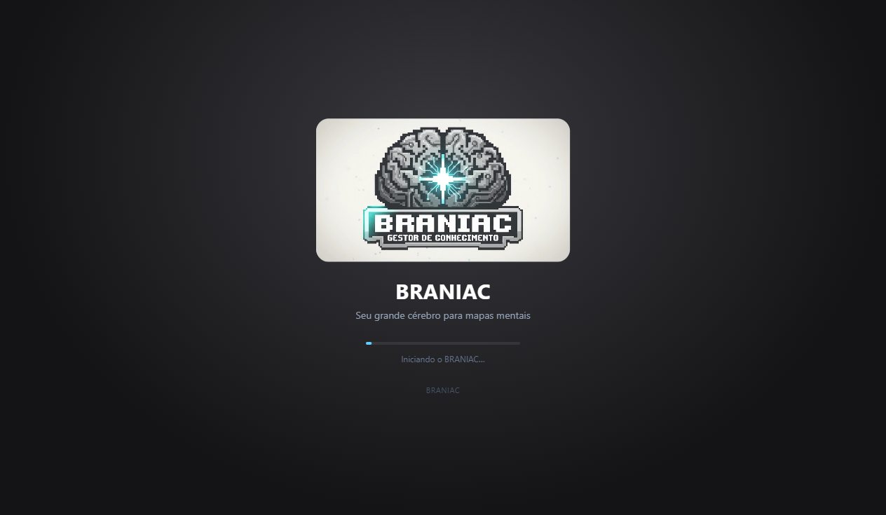
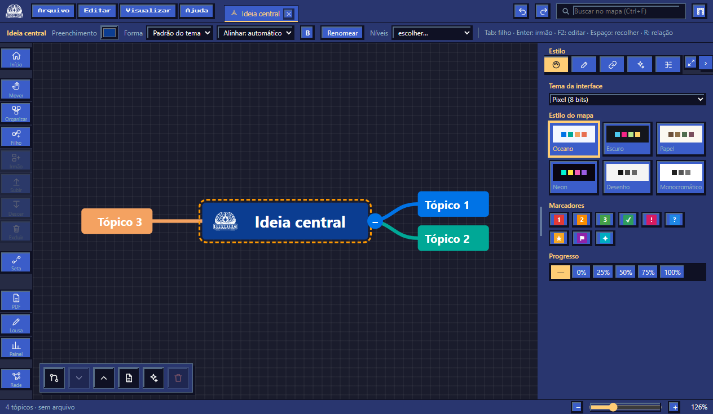
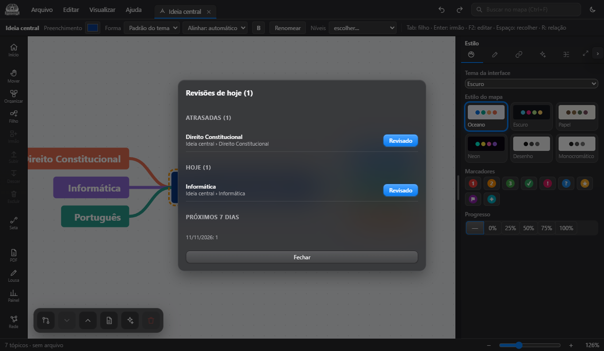

# BRANIAC

**Mapas mentais para organizar o estudo.** Monte o mapa do conteúdo, abra o PDF ao lado, marque o que já foi revisado e deixe o app avisar quando chegar a hora de revisar.

- Desktop: **Windows** (instalador). macOS e Linux: gere a partir do código (ainda não validado nessas plataformas).
- Tablet: **Android** (APK).
- Compatível com arquivos **Mindomo `.mom`**: abre, salva e preserva o que não entende.

Versão atual: **0.7.9**. Histórico completo em [CHANGELOG.md](CHANGELOG.md).

**Projeto aberto a contribuições.** Relate problemas, proponha melhorias e envie pull requests pelo [GitHub](https://github.com/iratuan/mindCraft). Leia [Como contribuir](docs/CONTRIBUTING.md) antes de alterar o código.

## Telas

| Tela inicial da abertura | Mapa com a logomarca nova |
|---|---|
|  |  |
| **Tema Pixel (8 bits)** | **Revisões de hoje** |
|  |  |

## Funcionalidades

### Mapa mental
- Criar, renomear, excluir, mover e recolher tópicos (Tab e Enter para filho e irmão, F2 para renomear, Espaço para recolher).
- Criar **tópicos flutuantes** (independentes da árvore) pela barra lateral ou menu Editar.
- Desfazer e refazer (Ctrl+Z e Ctrl+Y).
- Notas e links `[[entre tópicos]]`.
- Busca no mapa (Ctrl+F).
- Marcadores de prioridade e progresso por tópico.
- Temas do mapa (Oceano, Escuro, Papel, Neon, Desenho, Monocromático).
- Fluxograma e lousa de resolução.
- **Auto-organizar o mapa:** refaz a disposição de todos os níveis (inclusive mapas com vários subtópicos em cada ramo), sem recolher nenhum ramo. Recolher é uma decisão sua, pelo controle Níveis ou pelo botão em cada tópico.

### Aparência
- **Tema da interface:** Escuro, Claro, Desenho à mão e **Pixel (8 bits)**. O contraste dos textos e elementos do mapa se adapta ao canvas claro e ao escuro. O Pixel usa paleta discreta, bordas em degrau e fonte pixel nos títulos; o leitor de PDF e a lousa ficam claros para a leitura.
- Painel lateral recolhível (Ctrl+\\) e divisores arrastáveis.

### Estudo e revisão
- **Marcar tópico como revisado** (Editar › Marcar tópico como revisado). A próxima revisão segue os intervalos de **1, 7, 15, 30, 60 e 120 dias**; depois disso, sempre 120.
- **Revisões de hoje** (Visualizar › Revisões de hoje…): lista as revisões do dia e as atrasadas, com o botão **Revisado** e a previsão dos próximos 7 dias.
- **Aviso diário:** uma vez por dia, quando há revisões pendentes, o desktop mostra um aviso do sistema. A barra de status mostra a contagem em qualquer aparelho. O aviso só aparece com o app aberto.
- PDF ao lado do mapa.

### Dados e exportação
- Abrir e salvar arquivos `.mom`.
- Exportar o material de estudo em **PDF** e **Markdown**.
- **Rede de conhecimento:** visualiza o mapa como rede de ligações e exporta para o **Obsidian** (abre o cofre direto no Obsidian).
- Cópia de segurança e restauração de versões anteriores.
- Importar CSV (por arquivo ou colado).

## Instalar

**Windows:** baixe `BRANIAC Setup 0.7.9.exe` na página de [Releases](https://github.com/iratuan/mindCraft/releases/latest) e execute. O instalador não é assinado; se o Windows mostrar um aviso de editor desconhecido, confira se baixou o arquivo desta página e escolha "Mais informações" → "Executar assim mesmo".

**Android:** baixe `BRANIAC-0.7.9.apk` na página de [Releases](https://github.com/iratuan/mindCraft/releases/latest). O Android pode pedir autorização para instalar apps desta origem. Instale apenas APKs publicados nas Releases deste repositório.

**macOS e Linux:** sem instalador publicado. Gere a partir do código (veja abaixo).

## Usar

1. Abra o app e crie um mapa novo, ou importe um CSV de conteúdo.
2. Estude cada tópico com o PDF ao lado. Ao terminar, marque o tópico como revisado.
3. Abra **Revisões de hoje** para fazer a fila do dia. Quando o aviso chegar, é o sinal para começar por ela.
4. Faça uma cópia de segurança de vez em quando e guarde o arquivo fora do computador.

Atalhos completos: **F1**.

## Para desenvolver

### Requisitos

- Windows 10 ou superior para executar e empacotar o desktop.
- Node.js LTS e npm.
- JDK 21 e Android SDK para compilar a versão Android.
- Git para trabalhar em uma cópia do repositório.

### Desktop

```bash
npm ci
npm start          # abre o app
npm run check      # lint e testes unitários
npm run e2e        # testes ponta a ponta no Electron real
npm run dist       # gera o instalador do Windows em dist/
```

### Android

```powershell
npm --prefix tablet ci
npm --prefix tablet run sync
cd tablet\android
.\gradlew.bat assembleRelease
```

O APK é gerado em `tablet/android/app/build/outputs/apk/release/app-release.apk`. Para um build de desenvolvimento sem a chave privada, use `.\gradlew.bat assembleDebug`. A assinatura de release depende da chave local em `tablet/keystore/`; ela não é distribuída nem deve ser enviada ao Git.

## Colaborar

1. Abra uma [issue](https://github.com/iratuan/mindCraft/issues) para relatar um erro, discutir uma mudança ou verificar se alguém já está trabalhando nela.
2. Faça um fork, crie uma branch para sua alteração e mantenha o escopo do pull request pequeno.
3. Siga as convenções e os limites de arquitetura descritos em [CLAUDE.md](CLAUDE.md), [docs/ARCHITECTURE.md](docs/ARCHITECTURE.md) e [docs/CONTRIBUTING.md](docs/CONTRIBUTING.md).
4. Rode `npm run check` e os testes ponta a ponta relevantes. Mudanças que afetam a interface devem ser verificadas também no tablet; descreva no pull request o que foi testado e o que não foi.
5. Não inclua arquivos pessoais, mapas, credenciais, keystore, APKs, instaladores, `node_modules/` ou arquivos gerados. O checklist completo está em [Como contribuir](docs/CONTRIBUTING.md).

## Estrutura do projeto

`core/components/`, `core/services/`, `core/formats/` e `core/utils/` (regras compartilhadas) · `electron/` (processo principal) · `renderer/` (interface) · `platform/web/` (compatibilidade tablet) · `tablet/` (Capacitor/Android) · `test/`.

Documentação para quem vai evoluir o projeto:
- [`CLAUDE.md`](CLAUDE.md): regras, comandos e armadilhas. Comece por aqui.
- [`docs/ARCHITECTURE.md`](docs/ARCHITECTURE.md) e [`docs/DECISIONS.md`](docs/DECISIONS.md)
- [`docs/TESTING.md`](docs/TESTING.md) e [`docs/CONTRIBUTING.md`](docs/CONTRIBUTING.md)
- [`CHANGELOG.md`](CHANGELOG.md)

## Limitações conhecidas

- **Recursos de estudo do histórico que não estão neste repositório:** painel de estudos, caderno de erros, simulados, metas, modelos de concurso, agenda de revisões em `.ics`, sincronização com Google Drive, navegador embutido e player de videoaulas. Eles aparecem no CHANGELOG das versões 0.1.x a 0.7.1 e foram mantidos como histórico. Os itens afetados estão marcados com ⚠️ lá.
- **Aviso diário:** só dispara com o app aberto (verifica 4 segundos após abrir e depois a cada 30 minutos). O aviso do sistema foi confirmado só no processo do app, não visto na tela do Windows.
- **Mapas grandes:** com centenas de tópicos, o botão Ajustar à tela deixa o mapa pequeno e o texto só fica legível com zoom.
- **Tablet:** o APK foi gerado e assinado, mas não foi instalado nem testado em aparelho nesta versão. No tablet não há aviso do sistema para as revisões.
- **Instaladores sem assinatura de código:** o Windows e o macOS mostram avisos na primeira execução.
- **Mindomo:** ícones, anexos, tarefas e Gantt não são importados. Relações do Mindomo são preservadas no arquivo, mas não aparecem no mapa. Tópicos soltos são só de leitura até serem trazidos para a árvore.
- **macOS e Linux:** os builds vêm do CI (`.github/workflows/build.yml`) e ainda não foram validados nessas plataformas.

## Licenças

Código sob a licença MIT (veja `package.json`). A fonte do tema pixel é a Press Start 2P, sob a licença SIL Open Font License (`renderer/assets/fonts/PressStart2P-OFL.txt`). O leitor de PDF usa o PDF.js (Mozilla, Apache 2.0); a interface usa React (MIT).
