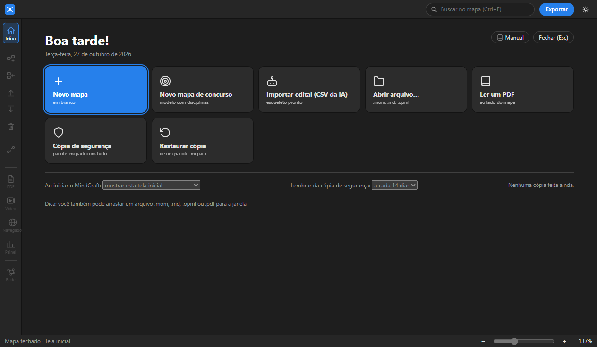
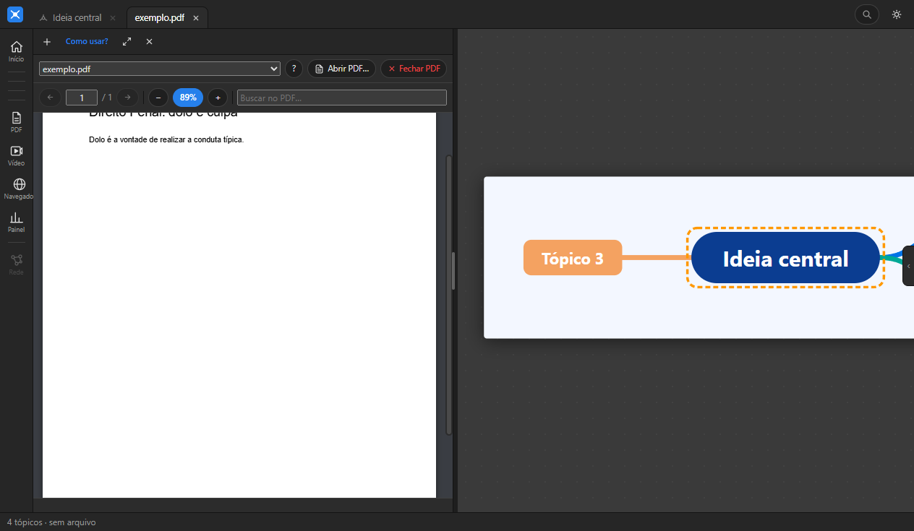
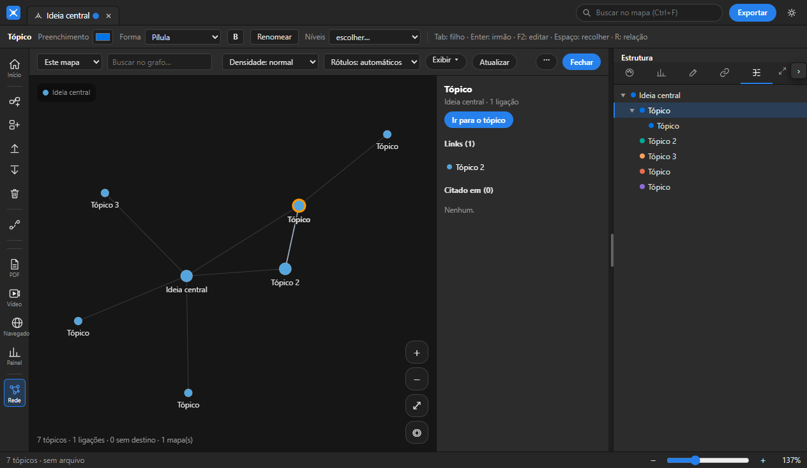
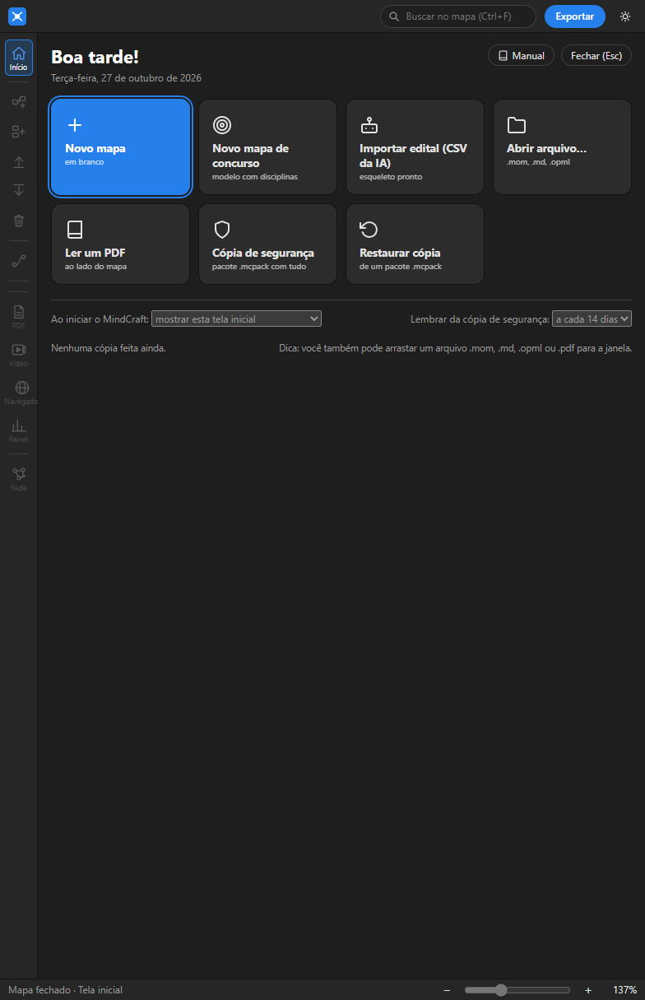

# MindCraft

**Mapas mentais e rotina de estudos para concursos e provas.** Você monta o mapa do edital, estuda cada tópico com PDF, vídeo e questões ao lado, e o app avisa quando é hora de revisar.

- Desktop: **Windows** (instalador) · **macOS** e **Linux** (gerados a partir do código)
- Tablet: **Android** (APK)
- Compatível com arquivos **Mindomo `.mom`**: abre, salva e preserva o que não entende

## Telas

| Tela inicial | Leitor de PDF ao lado do mapa |
|---|---|
|  |  |
| **Rede de conhecimento** | **Tablet** |
|  |  |

## Funcionalidades

<!-- funcionalidades:inicio -->

Cada funcionalidade abaixo foi executada no app (41 testadas e ok, 2 não testadas neste ambiente). Atualizado em 2026-10-27 por `npm run evidence`; as capturas ficam em [docs/evidencias](docs/evidencias/README.md).

### Início e primeiro uso

| Funcionalidade | Status | Evidência |
|---|---|---|
| Tela inicial com os atalhos para começar | ✅ ok | [tela-inicial.png](docs/evidencias/inicio/tela-inicial.png) |
| Sem mapa aberto, o painel lateral some e a tela fica limpa | ✅ ok | [sem-mapa-sem-painel.png](docs/evidencias/inicio/sem-mapa-sem-painel.png) |
| Manual de uso (Ajuda → Manual de uso), com índice e busca | ✅ ok | [manual-de-uso.png](docs/evidencias/inicio/manual-de-uso.png) |
| Lista de atalhos do teclado (F1) | ✅ ok | [atalhos-do-teclado.png](docs/evidencias/inicio/atalhos-do-teclado.png) |

### Editar o mapa

| Funcionalidade | Status | Evidência |
|---|---|---|
| Novo mapa em branco | ✅ ok | [novo-mapa-em-branco.png](docs/evidencias/mapas/novo-mapa-em-branco.png) |
| Criar tópico filho (Tab) e irmão (Enter) | ✅ ok | [criar-topico-filho-e-irmao.png](docs/evidencias/mapas/criar-topico-filho-e-irmao.png) |
| Renomear o tópico (botão Renomear ou F2) | ✅ ok | [renomear-topico.png](docs/evidencias/mapas/renomear-topico.png) |
| Excluir tópico (botão na lateral ou Del) | ✅ ok | [excluir-topico.png](docs/evidencias/mapas/excluir-topico.png) |
| Desfazer e refazer (Ctrl+Z e Ctrl+Y) | ✅ ok | [desfazer-e-refazer.png](docs/evidencias/mapas/desfazer-e-refazer.png) |
| Recolher e expandir um ramo (tecla Espaço) | ✅ ok | [recolher-ramo.png](docs/evidencias/mapas/recolher-ramo.png) |
| Forma do tópico (barra do tópico) | ✅ ok | [forma-do-topico.png](docs/evidencias/mapas/forma-do-topico.png) |
| Notas e links [[entre tópicos]] | ✅ ok | [notas-e-links-entre-topicos-notas.png](docs/evidencias/mapas/notas-e-links-entre-topicos-notas.png) · [notas-e-links-entre-topicos-conexoes.png](docs/evidencias/mapas/notas-e-links-entre-topicos-conexoes.png) |

### Aparência e painéis

| Funcionalidade | Status | Evidência |
|---|---|---|
| Buscar no mapa (Ctrl+F) | ✅ ok | [busca-no-mapa.png](docs/evidencias/estilo/busca-no-mapa.png) |
| Tema visual do mapa (Oceano, Neon, Papel…) | ✅ ok | [tema-do-mapa.png](docs/evidencias/estilo/tema-do-mapa.png) |
| Marcadores de prioridade no tópico | ✅ ok | [marcadores.png](docs/evidencias/estilo/marcadores.png) |
| Estrutura do mapa em árvore (aba Estrutura) | ✅ ok | [estrutura-em-arvore.png](docs/evidencias/estilo/estrutura-em-arvore.png) |
| Recolher e reabrir o painel lateral | ✅ ok | [painel-lateral-recolher-recolhido.png](docs/evidencias/estilo/painel-lateral-recolher-recolhido.png) · [painel-lateral-recolher-aberto.png](docs/evidencias/estilo/painel-lateral-recolher-aberto.png) |
| Maximizar e restaurar o painel | ✅ ok | [painel-maximizar.png](docs/evidencias/estilo/painel-maximizar.png) |
| Rede de conhecimento (o mapa como rede de conexões) | ✅ ok | [rede-de-conhecimento.png](docs/evidencias/estilo/rede-de-conhecimento.png) |

### Estudo e revisão

| Funcionalidade | Status | Evidência |
|---|---|---|
| Estudo do tópico: revisão, tempo e questões | ✅ ok | [painel-do-topico.png](docs/evidencias/estudo/painel-do-topico.png) |
| Marcar "Estudei hoje" e "Errei" (agenda a próxima revisão) | ✅ ok | [estudei-hoje-e-errei-estudei.png](docs/evidencias/estudo/estudei-hoje-e-errei-estudei.png) · [estudei-hoje-e-errei-errei.png](docs/evidencias/estudo/estudei-hoje-e-errei-errei.png) |
| Registrar minutos de estudo | ✅ ok | [minutos-de-estudo.png](docs/evidencias/estudo/minutos-de-estudo.png) |
| Caderno de erros, com o motivo de cada erro | ✅ ok | [caderno-de-erros.png](docs/evidencias/estudo/caderno-de-erros.png) |
| Painel de estudos (progresso, sequência e metas) | ✅ ok | [painel-de-estudos.png](docs/evidencias/estudo/painel-de-estudos.png) |
| Revisão do dia (tópicos vencidos) | ✅ ok | [revisao-do-dia.png](docs/evidencias/estudo/revisao-do-dia.png) |
| Registrar simulado por disciplina | ✅ ok | [simulado.png](docs/evidencias/estudo/simulado.png) |

### Criar e importar mapas

| Funcionalidade | Status | Evidência |
|---|---|---|
| Novo mapa de concurso: escolher um modelo pronto | ✅ ok | [modelos-de-concurso-escolha.png](docs/evidencias/importar/modelos-de-concurso-escolha.png) · [modelos-de-concurso-mapa.png](docs/evidencias/importar/modelos-de-concurso-mapa.png) |
| Importar o CSV colado (resposta da IA), com prévia | ✅ ok | [csv-colado-da-ia-colagem.txt](docs/evidencias/importar/csv-colado-da-ia-colagem.txt) · [csv-colado-da-ia-previa.png](docs/evidencias/importar/csv-colado-da-ia-previa.png) · [csv-colado-da-ia-mapa.png](docs/evidencias/importar/csv-colado-da-ia-mapa.png) |
| Importar edital colando o texto do conteúdo programático | ✅ ok | [importar-edital-por-texto.png](docs/evidencias/importar/importar-edital-por-texto.png) |

### Dados, exportação e biblioteca

| Funcionalidade | Status | Evidência |
|---|---|---|
| Biblioteca de mapas (todos os mapas guardados) | ✅ ok | [biblioteca-de-mapas.png](docs/evidencias/dados/biblioteca-de-mapas.png) |
| Exportar em Markdown (.md) | ✅ ok | [exportar-markdown.md](docs/evidencias/dados/exportar-markdown.md) |
| Exportar em OPML (para outros programas de mapas) | ✅ ok | [exportar-opml.opml](docs/evidencias/dados/exportar-opml.opml) |
| Exportar em PDF | ✅ ok | [exportar-pdf.pdf](docs/evidencias/dados/exportar-pdf.pdf) |
| Exportar em Word (.docx) | ✅ ok | [exportar-word.docx](docs/evidencias/dados/exportar-word.docx) |
| Abrir e salvar no formato do Mindomo (.mom) sem perder dados | ✅ ok | [mindomo-mom.txt](docs/evidencias/dados/mindomo-mom.txt) |
| Agenda de revisões e provas (.ics, para o calendário) | ✅ ok | [agenda-ics.ics](docs/evidencias/dados/agenda-ics.ics) · [agenda-ics-resumo.txt](docs/evidencias/dados/agenda-ics-resumo.txt) |
| Importar um mapa a partir de Markdown | ✅ ok | [importar-markdown.txt](docs/evidencias/dados/importar-markdown.txt) |
| Cópia de segurança em pacote (.mcpack) com a biblioteca | ✅ ok | [backup-pacote.txt](docs/evidencias/dados/backup-pacote.txt) |
| Sincronização com Google Drive ou pasta | ⚪ não testado | — |

### PDF, vídeo e navegador

| Funcionalidade | Status | Evidência |
|---|---|---|
| Leitor de PDF ao lado do mapa (criar tópico a partir de um trecho) | ✅ ok | [leitor-de-pdf.png](docs/evidencias/midias/leitor-de-pdf.png) |
| Player de vídeo para videoaulas (arquivo local ou YouTube) | ⚪ não testado | [player-de-video.png](docs/evidencias/midias/player-de-video.png) |
| Navegador web ao lado do mapa (questões e leis) | ✅ ok | [navegador-web.png](docs/evidencias/midias/navegador-web.png) |

### Tablet

| Funcionalidade | Status | Evidência |
|---|---|---|
| Tela inicial em formato de tablet (retrato) | ✅ ok | [tela-inicial-retrato.png](docs/evidencias/tablet/tela-inicial-retrato.png) |

<!-- funcionalidades:fim -->

## Instalar

**Windows:** baixe `MindCraft Setup x.y.z.exe` na página de [releases](https://github.com/iratuan/mindCraft/releases) e execute. O instalador não é assinado, então o Windows pode mostrar um aviso de editor desconhecido: clique em "Mais informações" e depois "Executar assim mesmo".

**Android:** baixe `MindCraft-x.y.z.apk`, abra o arquivo e permita a instalação de fontes desconhecidas quando o aparelho pedir.

**macOS e Linux:** ainda sem instalador publicado. Gere a partir do código (veja abaixo) com `npm run dist`. No macOS, a primeira abertura pede confirmação em "Ajustes → Privacidade e Segurança".

## Usar

1. Abra o app e escolha **Novo mapa de concurso** ou **Importar edital**.
2. Estude cada tópico: peso, cronômetro e questões no painel da direita. O PDF, o vídeo ou o navegador ficam à esquerda.
3. Toda manhã, abra o **Painel de estudos** (Ctrl+E) e faça a fila de revisões.
4. Faça uma **cópia de segurança** de vez em quando (Tela inicial). Guarde o arquivo fora do computador.

Atalhos completos: **F1** ou Ajuda → Atalhos. Explicações de cada função: Ajuda → Manual de uso.

## Para desenvolver

```bash
npm install
npm start          # abre o app
npm run check      # lint + testes unitários + paridade com o núcleo web
npm run e2e        # testes ponta a ponta no Electron real (34 etapas)
npm run qa         # QA por funcionalidade, com entrada real (81 casos)
npm run dist       # instalador do sistema atual, em dist/
```

Android: `cd tablet && node scripts/release.js` gera e assina o APK em `dist/` (junto com os instaladores Windows). A chave de assinatura fica em `tablet/keystore/`, fora do Git: **faça uma cópia**, sem ela não é possível atualizar o app instalado.

Estrutura: `core/` (regras de negócio puras, sem Electron nem DOM) · `electron/` (processo principal) · `renderer/` (interface) · `platform/` (versão web, para o tablet) · `tablet/` (Capacitor) · `test/`.

Documentação para quem vai evoluir o projeto:
- [`CLAUDE.md`](CLAUDE.md): regras, comandos e armadilhas. Comece por aqui.
- [`docs/ARCHITECTURE.md`](docs/ARCHITECTURE.md) e [`docs/DECISIONS.md`](docs/DECISIONS.md): arquitetura e decisões
- [`docs/TESTING.md`](docs/TESTING.md) e [`docs/CONTRIBUTING.md`](docs/CONTRIBUTING.md): testes e contribuição
- [`CHANGELOG.md`](CHANGELOG.md): histórico de versões

## Limitações conhecidas

- **Mindomo:** ícones, anexos, tarefas e Gantt não são importados. Relações do Mindomo são preservadas no arquivo, mas ainda não aparecem no mapa. Tópicos soltos são só de leitura até serem trazidos para a árvore.
- **Sincronização com Google Drive:** testada apenas contra um servidor de testes. Ainda não validada com uma conta real.
- **Instaladores sem assinatura de código:** o Windows e o macOS mostram avisos na primeira execução.
- **PDF:** fonte DejaVu (latim, grego e cirílico). Não há suporte a CJK.
- **Cronômetro:** os minutos só são gravados quando você para.
- **macOS e Linux:** os builds vêm do CI (`.github/workflows/build.yml`) e ainda não foram validados nessas plataformas.

## Licenças

Código sob a licença MIT (veja `package.json`). O leitor de PDF usa o PDF.js (Mozilla, Apache 2.0); a interface usa React (MIT).
