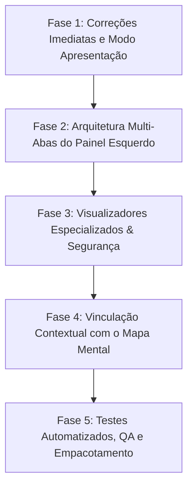

# Plano Mestre — Correções Funcionais e Evolução da Arquitetura do MindCraft

Este documento consolida o **plano diretor de evolução arquitetural, correções funcionais e modernização de experiência (UX/UI)** do **MindCraft**, derivado do *Prompt Mestre de Correções e Evolução*.

O foco principal é estruturar o ecossistema do aplicativo em torno dos seus dois pilares centrais — o **Mapa Mental** e a **Rede de Conhecimento** —, complementados por uma bancada de estudos integrada (**Study Workbench**) com múltiplas abas, modo de apresentação completo e vinculação orgânica de materiais aos contextos de aprendizagem.

---

## 1. Diretrizes Fundamentais e Arquitetura do Projeto

### 1.1 Princípio de Preservação e Não Regressão
- **Trabalhar sobre a base existente:** o projeto possui um núcleo maduro (`core/`), interface híbrida limpa (`renderer/` clássico + React modular em `renderer/react/`) e camada de abstração multiplataforma para desktop (Electron) e tablet (Capacitor/Android Web em `platform/web/`).
- **Zero regressões:** manutenção rigorosa da compatibilidade com arquivos `.mom` (Mindomo), banco SQLite de biblioteca, gravação atômica (`.tmp` + rename) e garantia de aprovação dos 276 testes automatizados (`npm run check`).
- **Camadas estritas (conforme [ARCHITECTURE.md](ARCHITECTURE.md)):**
  - `core/`: 100% puro (sem DOM, sem Electron), CommonJS puro e testável no Node e empacotado para o browser via `core-browser.js`.
  - `renderer/`: interface visual e pontes de eventos (`context-ui.js`, `renderer.js`, `study-ui.js`, `react-bridge.js`).
  - `platform/`: hospedeiro virtual que emula IPC e filesystem no tablet Android.

---

## 2. Visão de Domínio: Centralidade no Conhecimento

```
                       ┌──────────────────────────────────────────────┐
                       │         Contexto de Estudo / Meta            │
                       │   (Concurso Público · Disciplina · Exame)    │
                       └──────────────────────┬───────────────────────┘
                                              │
                    ┌─────────────────────────┴─────────────────────────┐
                    ▼                                                   ▼
       ┌────────────────────────┐                          ┌────────────────────────┐
       │      MAPA MENTAL       │◄════════════════════════►│  REDE DE CONHECIMENTO  │
       │ (Hierarquia & Tópicos) │      Relações R /        │ (Grafo, Links [[ ]]    │
       │  core/model · svg      │      Conexões lógicas    │  core/graph · links)   │
       └───────────┬────────────┘                          └───────────┬────────────┘
                   │                                                   │
                   │           Recursos e Ferramentas de Apoio         │
                   └──────────────────────────┬────────────────────────┘
                                              ▼
               ┌─────────────────────────────────────────────────────────────┐
               │              Bancada de Estudos Multimídia                  │
               │  • Painel Multi-Abas: PDFs, Páginas Web, Vídeos, YouTube    │
               │  • Notas em Markdown (Obsidian-ready)                       │
               │  • Caderno de Erros, Revisão Espaçada (SRS) e Metas         │
               │  • Cronogramas e Importação de Editais / CSV                │
               └─────────────────────────────────────────────────────────────┘
```

### 2.1 Modelo Conceitual de Vínculos
1. **Material Temporário vs. Material Persistido:**
   - **Temporário:** recurso aberto pelo usuário em uma aba para consulta pontual durante a sessão (não polui o arquivo nem a biblioteca).
   - **Persistido / Vinculado:** recurso atrelado a um nó do mapa, a uma disciplina ou ao concurso. Fechar a aba de leitura **nunca** desfaz o vínculo persistente.
2. **Cardinalidade Flexível:**
   - Um tópico pode apontar para um PDF com página e destaque específicos (`core/pdfrefs.js`).
   - Um tópico pode possuir múltiplos timestamps de vídeo (`core/video.js`).
   - Um material de referência geral (ex.: edital ou gramática completa) pode estar associado ao contexto global do mapa.

---

## 3. Especificação das Correções e Novas Funcionalidades

### 3.1 Correção do Botão de Apresentação (`Play`)
- **Problema Atual:** o botão de apresentação (`[data-act="present"]`) permanece visível na barra de ferramentas mesmo quando não há mapa ativo (tela inicial, mapa fechado ou ambiente descarregado).
- **Comportamento Esperado:**
  - O botão deve refletir o estado de `map` ativo. Se `map === null` ou se a Tela Inicial estiver aberta (`MCReact.homeIsOpen()`), o botão deve ser ocultado ou desabilitado via `syncContextUI()`.
  - Integrado ao ciclo de vida reativo da aplicação (`mc:render`, carregamento de arquivo, novo mapa, fechar mapa).

### 3.2 Modo de Apresentação Funcional com Navegação e Saída
- **Objetivo:** transformar a apresentação em um visualizador focado, fluido e intuitivo para revisão e aulas.
- **Requisitos de UX/UI:**
  - **Barra de Navegação Flutuante:** exibida no rodapé ou topo com controles minimalistas e elegantes:
    - Botão **Anterior** (`←` ou `Shift+Espaço`).
    - Indicador de Posição: `"Tópico X de Y"` com título do slide atual.
    - Botão **Próximo** (`→`, `Espaço` ou `Enter`).
    - Botão **Sair da Apresentação** (`Esc` ou botão `✕ Sair` claramente visível).
  - **Destaque e Foco:**
    - Centralização suave (`pan`, `zoom` / `fit`) no tópico corrente.
    - Ocultação das barras de ferramentas de edição durante a apresentação, mantendo a tela imersiva.
  - **Preservação de Contexto:** ao sair, restaurar a visualização, zoom e seleção anteriores sem disparar perda de edições nem descartes acidentais.

### 3.3 Painel Esquerdo Multi-Abas (Study Workbench)
- **Objetivo:** permitir que o estudante mantenha múltiplos materiais de apoio abertos simultaneamente ao lado do mapa mental, alternando entre eles com rapidez.
- **Tipos de Conteúdo Suportados:**
  1. **Documentos PDF (`tab.type = 'pdf'`):**
     - Leitor integrado com zoom, navegação de páginas, atalho para abrir novo arquivo e salto para páginas vinculadas a tópicos.
  2. **Navegador Web Integrado (`tab.type = 'browser'`):**
     - Barra de endereços com validação e normalização de URL (`https://`).
     - Proteção e fallback para políticas de segurança (`X-Frame-Options` e `CSP`): detecção de falha de carregamento em `iframe` com oferta imediata de **"Abrir em janela externa / navegador padrão"**.
     - Esquemas restritos: bloqueio de `javascript:`, `file:` e `data:`.
  3. **Vídeos Locais (`tab.type = 'video'`):**
     - Seleção de arquivos (`.mp4`, `.webm`, `.mkv`) através do diálogo seguro do sistema.
     - Player nativo com controles completos, velocidade de reprodução (1x, 1.25x, 1.5x, 2x) e liberação de `URL.revokeObjectURL()` ao fechar a aba.
  4. **Vídeos do YouTube (`tab.type = 'youtube'`):**
     - Reconhecimento inteligente de URLs: `youtube.com/watch?v=...`, `youtu.be/...`, `embed/...`.
     - Extração segura do ID do vídeo e incorporação via `www.youtube-nocookie.com/embed/<id>`.
     - Suporte a timestamps de início (`&t=120s`).
- **Comportamento das Abas:**
  - Barra de abas com scroll horizontal suave.
  - Título dinâmico por aba com ícone identificador do tipo (PDF, Web, Vídeo, YouTube).
  - Botão de fechar individual (`✕`) em cada aba.
  - Ao fechar a aba ativa, foco automático na aba vizinha; ao fechar todas, exibição de tela vazia com atalhos rápidos para abrir novos materiais.
  - Divisor arrastável (`#pdfsplit`) preservando redimensionamento responsivo tanto no desktop quanto no tablet.

---

## 4. Mapeamento de Arquivos do Projeto

| Funcionalidade | Arquivos Responsáveis | Natureza da Modificação |
|---|---|---|
| Visibilidade do Play | `renderer/context-ui.js`, `renderer/index.html` | Incluir controle reativo do botão `present` em `syncContextUI()`. |
| Navegação na Apresentação | `renderer/renderer.js`, `renderer/style.css` | Criar overlay de controle com Anterior, Próximo, Contador "X de Y" e botão Sair. |
| Gerenciador Multi-Abas | `renderer/react/MediaPane.jsx`, `renderer/react/index.jsx` | Refatorar `activeMediaTab` único para lista de abas `tabs: []` com estado isolado. |
| Leitor de PDF | `renderer/react/PdfPane.jsx`, `core/pdfrefs.js` | Suportar instâncias em abas e vinculação ao tópico ativo. |
| Navegador Web | `renderer/react/BrowserPane.jsx` | Tratar fallbacks de CSP/X-Frame-Options e navegação por abas. |
| Player de Vídeos / YouTube | `renderer/react/VideoPane.jsx`, `core/video.js` | Suporte a arquivos locais e embeds com preservação de tempo e descarte seguro. |
| Vinculação ao Modelo | `core/model.js`, `core/mom.js`, `renderer/notes-ui.js` | Estruturar metadados de mídia associada aos nós sem quebrar schema `.mom`. |

---

## 5. Plano de Implementação Faseado



### Fase 1: Correção do Botão Play e Apresentação Flutuante
1. Atualizar `syncContextUI()` em `renderer/context-ui.js` para ocultar/desabilitar `[data-act="present"]` quando não houver mapa ativo ou quando Home estiver aberto.
2. Construir barra de controle flutuante do modo de apresentação em `renderer/renderer.js` e estilizar em `renderer/style.css`:
   - Botões de navegação, contador de progresso e botão explícito de sair.
   - Teclas de atalho ativas: `Space`/`Right` (próximo), `Shift+Space`/`Left` (anterior), `Esc` (sair).

### Fase 2: Sistema Multi-Abas do Painel Esquerdo
1. Refatorar `MediaPane.jsx` para suportar `tabs: [{ id, type, title, uri, state }]` e `activeTabId`.
2. Adicionar controles para:
   - Alternar entre abas ativas sem reiniciar estados dos visualizadores.
   - Fechar aba ativa ou inativa.
   - Botão `+` para abrir novo recurso (menu suspenso: PDF, Link Web, Vídeo Local, YouTube).
   - Tela vazia convidativa quando não houver abas abertas.

### Fase 3: Visualizadores & Resiliência Web
1. **PDF:** suporte a carregar instâncias independentes em abas diferentes.
2. **Web:** tratamento de erro com evento `onError` do iframe ou verificação de cabeçalhos via IPC, disponibilizando botão amigável para abrir externamente.
3. **Vídeo e YouTube:** integração de player nativo com controles de velocidade e embed seguro do YouTube.

### Fase 4: Integração de Recursos ao Domínio e Contexto
1. Permitir arrastar ou vincular um material aberto no painel a um nó selecionado do mapa mental.
2. Adicionar indicador visual no nó quando ele tiver mídias ou referências vinculadas.
3. Permitir que clicar em uma referência no nó abra diretamente a aba correspondente no painel esquerdo.

### Fase 5: Testes, Validação e Builds
1. Executar bateria de testes automatizados (`npm test`, `npm run check`).
2. Adicionar testes unitários para o gerenciador de abas e parsing de mídias.
3. Gerar artefatos finais: executável Windows (`dist/`) e APK assinado para o tablet Android (`tablet/dist/`).

---

## 6. Plano de Testes Obrigatório

### 6.1 Testes do Botão de Apresentação
- [ ] Início do app na Tela Inicial: botão Play indisponível/oculto.
- [ ] Abertura de mapa: botão Play torna-se visível e clicável.
- [ ] Fechamento de mapa: botão Play é imediatamente ocultado.
- [ ] Mapa sem tópicos filhos: comportamento gracioso sem erros no console.

### 6.2 Testes do Modo de Apresentação
- [ ] Navegação linear completa do primeiro ao último tópico.
- [ ] Verificação dos limites: não avança além do fim nem retrocede antes do início.
- [ ] Contador dinâmico (ex.: "1 de 15") atualizado a cada salto.
- [ ] Saída via botão `✕ Sair` e tecla `Esc`: retorno idêntico à visualização do editor com o mapa intacto.

### 6.3 Testes do Painel Multi-Abas
- [ ] Abertura de múltiplos PDFs simultâneos em abas distintas.
- [ ] Alternância entre aba de vídeo e aba de PDF sem reinício forçado da reprodução.
- [ ] Fechamento da aba ativa: foco transferido para a aba adjacente.
- [ ] Fechamento de todas as abas: exibição do estado vazio e liberação de memória/blobs.
- [ ] Redimensionamento da divisão lateral (`#pdfsplit`) funcionando no desktop e tablet.

### 6.4 Testes de Segurança e Resiliência Web
- [ ] URL com `javascript:` ou `file:` rejeitada com aviso claro.
- [ ] Site com bloqueio de iframe: exibição do botão de fallback para navegador externo.
- [ ] URL de YouTube em formatos variados: extração correta do ID e embed `nocookie`.

---

## 7. Critérios de Aceite e Conclusão

1. **Botão Play Reativo:** 100% condicionado à presença de um mapa mental ativo.
2. **Apresentação com Controles:** navegação funcional, indicador visual e botão de saída presente.
3. **Multi-Abas Operacional:** usuário pode manter abas de PDF, Web, Vídeo Local e YouTube no painel lateral esquerdo.
4. **Respeito ao Domínio:** mapa mental e rede de conhecimento preservados como o centro da aplicação.
5. **Estabilidade e Testes:** aprovação em todos os testes de arquitetura e regressão (`npm run check`).
6. **Deploy:** builds de release para Windows e Android prontos para distribuição.
