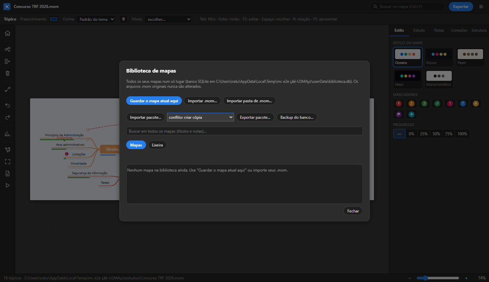

# Relatório de QA por funcionalidade

Gerado por `npm run qa` em 16/10/2026, 20:14:28 — entrada real (mouse/teclado via Chromium), app executando de verdade.

**1 de 1 funcionalidades OK**.

| # | Grupo | Funcionalidade | Como foi exercitada | Resultado | Captura |
|---|---|---|---|---|---|
| 75 | Mapa | Teclado real nas janelas: Tab circula só dentro delas, Esc fecha e o mapa nunca é alterado | Teclas reais (Tab, Shift+Tab, Delete, Esc) com a janela da biblioteca e a tela inicial abertas | ✅ OK | [75_janela-com-foco_teclado-real-nas-janelas-tab-circula-so-dentro-d](75_janela-com-foco_teclado-real-nas-janelas-tab-circula-so-dentro-d.png) |

## Capturas

### 75 · Mapa › Teclado real nas janelas: Tab circula só dentro delas, Esc fecha e o mapa nunca é alterado
✅ Teclas reais (Tab, Shift+Tab, Delete, Esc) com a janela da biblioteca e a tela inicial abertas

